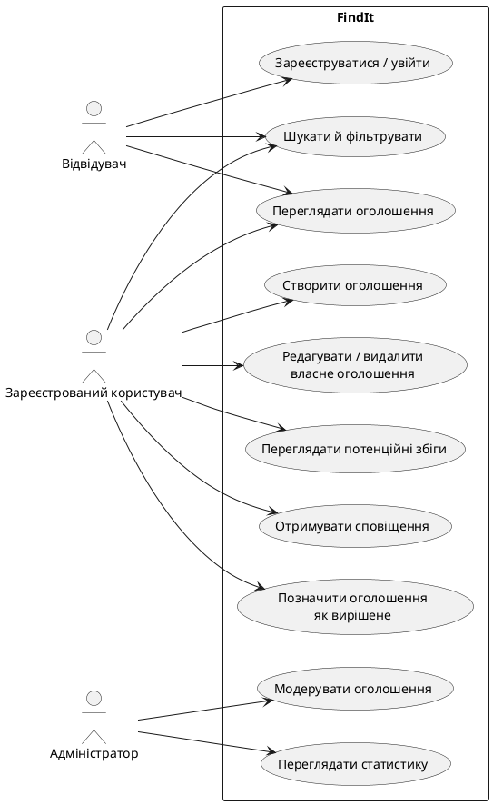

# FindIt — специфікація вимог до програмного забезпечення (SRS v1.0)

**Версія:** 1.0
**Статус:** початкова версія вимог
**Продукт:** вебсистема пошуку загублених і знайдених речей з інтелектуальним зіставленням оголошень

## 1. Призначення системи

FindIt призначена для того, щоб допомогти людям знаходити загублені речі та повертати знайдені предмети власникам. Система надає змогу публікувати оголошення, знаходити їх за заданими критеріями та автоматично отримувати рекомендації щодо потенційних збігів.

### 1.1. Предметна область

Облік оголошень про загублені й знайдені речі, пошук відповідних оголошень, сповіщення користувачів і модерація контенту.

### 1.2. Користувачі та ролі

- **Відвідувач:** переглядає активні оголошення, шукає та фільтрує їх.
- **Зареєстрований користувач:** створює оголошення, керує власними оголошеннями, переглядає потенційні збіги та сповіщення, позначає оголошення як вирішене.
- **Адміністратор:** перевіряє оголошення, приховує неприйнятний контент і переглядає статистику системи.

### 1.3. Бізнес-вимоги

- **BR-01:** система повинна спростити публікацію інформації про загублені та знайдені речі.
- **BR-02:** система повинна допомагати користувачам виявляти можливі збіги без необхідності вручну переглядати всі оголошення.
- **BR-03:** система повинна надавати адміністраторам засоби модерації та оглядову статистику для підтримки якості даних.

## 2. Функціональні вимоги

### FR-01. Реєстрація та вхід — пріоритет Must

Система повинна дозволяти користувачу створити обліковий запис із дійсною електронною адресою та паролем, увійти й вийти з облікового запису. Електронна адреса має бути унікальною. Якщо дані некоректні або обліковий запис уже існує, система повинна відхилити операцію та показати зрозуміле повідомлення.

**Перевірка:** успішна реєстрація з новою адресою; відмова в реєстрації з уже зареєстрованою адресою; відмова у вході з неправильним паролем.

### FR-02. Створення та керування оголошеннями — пріоритет Must

Зареєстрований користувач повинен мати змогу створити оголошення типу «Загублено» або «Знайдено». Оголошення повинно містити назву, опис, категорію, населений пункт або місце, дату події та тип оголошення. Фотографію можна додавати за бажанням. Автор повинен мати змогу редагувати або видаляти лише власні оголошення, а також позначати їх як «Вирішено».

**Перевірка:** коректне оголошення зберігається; пропуск обов’язкового поля спричиняє помилку валідації; користувач не може редагувати чи видаляти чуже оголошення.

### FR-03. Перегляд, пошук і фільтрація — пріоритет Must

Система повинна відображати активні оголошення та надавати пошук за словами в назві й описі. Користувач повинен мати змогу фільтрувати результати за типом оголошення, категорією, місцем і діапазоном дат, а також сортувати їх за датою публікації.

**Перевірка:** кожен результат відповідає заданим фільтрам; при відсутності результатів система показує повідомлення, що збігів не знайдено.

### FR-04. Автоматичне зіставлення оголошень — пріоритет Must

Система повинна автоматично оцінювати пари активних оголошень протилежних типів («Загублено» та «Знайдено») і присвоювати кожній парі оцінку відповідності від 0 до 100. Оцінка повинна обчислюватися за формулою:

`Score = 0,40 × Text + 0,25 × Category + 0,20 × Location + 0,15 × Date`

Усі складові формули мають значення від 0 до 100:

- **Text:** схожість текстових описів за TF-IDF і косинусною подібністю;
- **Category:** 100, якщо категорії збігаються, інакше 0;
- **Location:** 100, якщо збігається конкретне місце; 50, якщо збігається лише населений пункт; 0, якщо населений пункт різний;
- **Date:** 100 за однакової дати; 70, якщо різниця становить 1–3 дні; 40, якщо 4–7 днів; 0, якщо понад 7 днів.

Пари з оцінкою **60 або більше** повинні вважатися потенційними збігами. Система повинна показувати їх у порядку спадання оцінки та надавати користувачеві пояснення за основними критеріями оцінювання.

**Перевірка:** тестові пари з відомими категоріями, місцями, датами й текстами отримують очікувану оцінку за наведеною формулою; до результатів не потрапляють оголошення однакового типу або неактивні оголошення.

### FR-05. Потенційні збіги та сповіщення — пріоритет Must

Система повинна показувати власнику оголошення потенційні збіги з оцінкою 60 або більше та створювати внутрішнє сповіщення, коли з’являється новий відповідний збіг. Сповіщення повинно містити посилання на оголошення-кандидат та оцінку відповідності. Для тієї самої пари оголошень не можна створювати повторні однакові сповіщення.

**Перевірка:** після появи нового відповідного оголошення користувач бачить сповіщення; для повторного запуску зіставлення тієї самої пари дублікат сповіщення не створюється.

### FR-06. Модерація оголошень — пріоритет Should

Адміністратор повинен мати змогу переглядати оголошення, приховувати оголошення, що порушують правила користування, і відновлювати приховані оголошення. Для приховування адміністратор повинен зазначити причину. Приховані оголошення не повинні з’являтися у звичайному пошуку або використовуватися для формування потенційних збігів.

**Перевірка:** приховане оголошення відсутнє в публічному пошуку та зіставленні; адміністратор може переглянути причину й відновити оголошення.

### FR-07. Статистика — пріоритет Should

Адміністратор повинен мати змогу переглядати загальну кількість оголошень, кількість активних і вирішених оголошень, а також кількість оголошень за типом і категорією. Статистику повинно бути можливо обмежити діапазоном дат.

**Перевірка:** значення на панелі статистики відповідають кількості записів у базі даних, які задовольняють вибрані умови.

## 3. Нефункціональні вимоги

### NFR-01. Продуктивність — пріоритет Must

За тестового набору з 10 000 активних оголошень і 50 одночасних користувачів щонайменше 95% запитів пошуку та фільтрації повинні завершуватися не довше ніж за 2 секунди. Розрахунок потенційних збігів для одного нового оголошення має завершуватися не довше ніж за 5 секунд за тих самих умов.

**Перевірка:** навантажувальне тестування на визначеному тестовому наборі даних.

### NFR-02. Безпека — пріоритет Must

Паролі не повинні зберігатися у відкритому вигляді; для їх зберігання необхідно використовувати алгоритм хешування паролів, наприклад Argon2id або bcrypt. Сервер повинен перевіряти права доступу до кожної операції редагування та видалення. Лише адміністратор може виконувати дії модерації й переглядати адміністративну статистику.

**Перевірка:** перевірки підтверджують, що пароль у базі даних є хешем, користувач не може змінити чуже оголошення, а звичайний користувач не має доступу до адміністративних операцій.

### NFR-03. Сумісність і адаптивність — пріоритет Must

Основні сценарії користування повинні працювати в актуальній стабільній версії Google Chrome, Mozilla Firefox і Microsoft Edge на момент випуску версії продукту. Інтерфейс повинен залишатися придатним до використання на ширині екрана від 360 px без горизонтального прокручування основного вмісту сторінки.

**Перевірка:** ручне або автоматизоване проходження основних сценаріїв у зазначених браузерах і на ширині 360 px та більшій.

### NFR-04. Надійність і цілісність даних — пріоритет Must

Після перезапуску серверної частини всі успішно збережені оголошення й сповіщення повинні залишатися доступними. Якщо операція запису до бази даних завершується помилкою, система не повинна зберігати частково оновлений запис і повинна показувати користувачу повідомлення про невдалу операцію.

**Перевірка:** перезапуск застосунку не втрачає збережені дані; змодельована помилка запису не створює частково збереженого оголошення.

### NFR-05. Супроводжуваність і тестованість — пріоритет Must

Код повинен розділяти рівень представлення, бізнес-логіку та доступ до даних. Логіка зіставлення має бути реалізована окремим модулем, який можна тестувати без запуску вебінтерфейсу. Проєкт повинен містити щонайменше 8 unit-тестів бізнес-логіки, серед яких є не менше одного негативного сценарію.

**Перевірка:** структура коду демонструє розділення шарів; модуль зіставлення тестується ізольовано; автоматизований набір містить щонайменше 8 успішно виконаних unit-тестів та негативний сценарій.

## 4. User stories та критерії приймання

### US-01. Публікація оголошення

**User story:** Як зареєстрований користувач, я хочу створити оголошення про загублену або знайдену річ, щоб інші люди могли допомогти знайти її власника.

**Пріоритет:** Must.
**Пов’язані вимоги:** FR-01, FR-02.

**Критерії приймання:**

- **Given** користувач увійшов у систему, **When** він заповнює всі обов’язкові поля й публікує оголошення, **Then** оголошення зберігається зі статусом «Активне» і відображається в переліку.
- **Given** не заповнено хоча б одне обов’язкове поле, **When** користувач надсилає форму, **Then** система не зберігає оголошення та вказує на поля з помилками.
- **Given** оголошення належить іншому користувачу, **When** поточний користувач намагається його змінити або видалити, **Then** система відмовляє в операції.

### US-02. Пошук речі

**User story:** Як відвідувач, я хочу шукати та фільтрувати оголошення за описом, категорією, місцем і датою, щоб швидше знайти потрібну інформацію.

**Пріоритет:** Must.
**Пов’язана вимога:** FR-03.

**Критерії приймання:**

- **Given** у системі є активні оголошення, **When** відвідувач задає пошуковий запит і фільтри, **Then** у результатах відображаються лише оголошення, що відповідають усім вибраним фільтрам.
- **Given** жодне активне оголошення не відповідає запиту, **When** пошук завершено, **Then** система показує повідомлення, що результатів не знайдено.
- **Given** знайдено кілька оголошень, **When** відвідувач обирає сортування за датою, **Then** результати впорядковуються за датою публікації.

### US-03. Отримання потенційних збігів

**User story:** Як зареєстрований користувач, я хочу отримувати автоматичні рекомендації щодо схожих оголошень, щоб швидше знайти загублену річ або її власника.

**Пріоритет:** Must.
**Пов’язані вимоги:** FR-04, FR-05.

**Критерії приймання:**

- **Given** існують два активні оголошення протилежних типів, **When** система виконує зіставлення, **Then** вона розраховує оцінку за формулою з FR-04.
- **Given** оцінка пари становить 60 або більше, **When** система завершує зіставлення, **Then** пара відображається серед потенційних збігів і власник отримує внутрішнє сповіщення.
- **Given** пара оголошень уже оброблялася, **When** система повторно запускає зіставлення без зміни цієї пари, **Then** дублікат сповіщення не створюється.
- **Given** оголошення неактивне або обидва оголошення мають однаковий тип, **When** система виконує зіставлення, **Then** ця пара не відображається як потенційний збіг.

### US-04. Модерація контенту

**User story:** Як адміністратор, я хочу приховувати оголошення, що порушують правила, щоб підтримувати якість і безпечність контенту.

**Пріоритет:** Should.
**Пов’язана вимога:** FR-06.

**Критерії приймання:**

- **Given** адміністратор переглядає оголошення, **When** він приховує його із зазначенням причини, **Then** оголошення зникає з публічного пошуку та подальшого зіставлення.
- **Given** звичайний користувач намагається виконати дію модерації, **When** він надсилає такий запит, **Then** система відмовляє через недостатні права доступу.

## 5. Backlog першої версії

| ID | Елемент backlog | Пріоритет | Вимоги |
|---|---|---|---|
| US-01 | Реєстрація, вхід і створення оголошення | Must | FR-01, FR-02 |
| US-02 | Перегляд, пошук, фільтрація та сортування | Must | FR-03 |
| US-03 | Розрахунок оцінки збігу й внутрішні сповіщення | Must | FR-04, FR-05 |
| US-04 | Модерація оголошень | Should | FR-06 |
| US-05 | Панель статистики адміністратора | Should | FR-07 |
| NFR-01 | Вимоги до продуктивності | Must | NFR-01 |
| NFR-02 | Контроль доступу та захист паролів | Must | NFR-02 |
| NFR-03 | Сумісність та адаптивний інтерфейс | Must | NFR-03 |
| NFR-04 | Надійність збереження даних | Must | NFR-04 |
| NFR-05 | Модульність і unit-тестування | Must | NFR-05 |

## 6. Use Case Diagram



## 7. Припущення та обмеження першої версії

- Сповіщення реалізуються всередині вебзастосунку; електронні листи та push-сповіщення не входять до першої версії.
- Потенційним збігом вважається пара з оцінкою 60 або більше; поріг може бути змінений у майбутній версії.
- Результат алгоритму є рекомендацією, а не підтвердженням того, що знайдена річ належить конкретному користувачу.
- Статус «Вирішено» означає, що користувач більше не шукає допомоги за цим оголошенням; така публікація виключається з нового зіставлення.

## 8. Простежуваність вимог

- **US-01** реалізує **FR-01** і **FR-02**.
- **US-02** реалізує **FR-03**.
- **US-03** реалізує **FR-04** і **FR-05**.
- **US-04** реалізує **FR-06**.
- **FR-07** перевіряється через адміністративну панель статистики та звірку значень із базою даних.
- **NFR-01–NFR-05** перевіряються відповідно навантажувальними, безпековими, суміснісними, інтеграційними та модульними тестами.

## 9. Рекомендована структура каталогу

```text
requirements/
└── SRS_v1.md
```

Після узгодження вимог із викладачем варто оновити цей документ і додати до `README.md` посилання на розділ «Вимоги».
